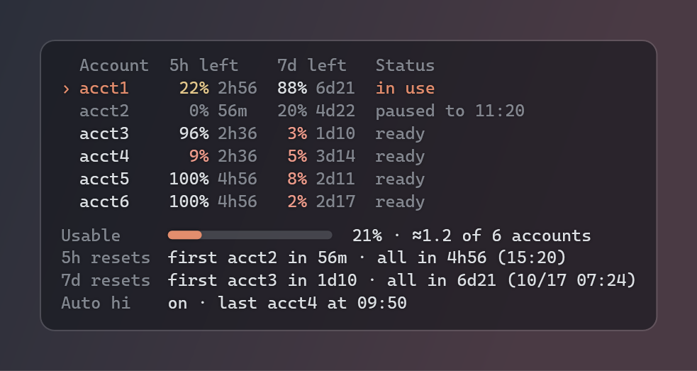
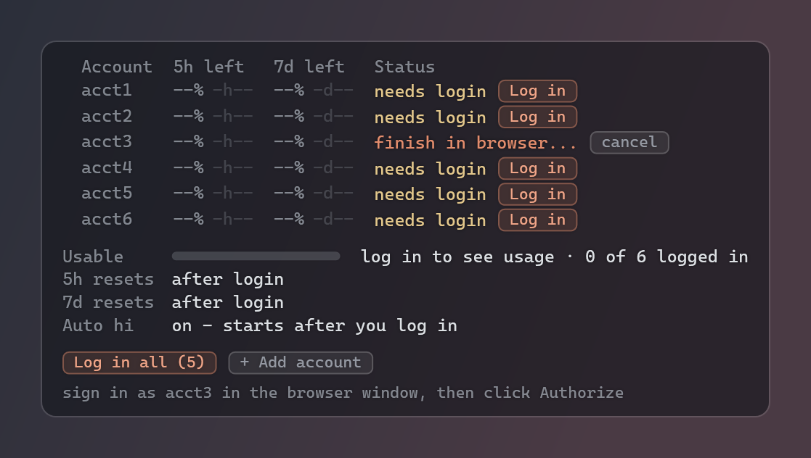

# claude-pool: run Claude Code across several Claude accounts and stop stalling on usage limits

**claude-pool** is a single-file, zero-dependency Node.js tool that pools several Claude subscriptions (Pro / Max)
for **Claude Code**. When the account a session runs on reaches its **5-hour** or **weekly usage limit**, claude-pool
switches to the account with the most headroom left. It then **resumes the same conversation**
(`claude --resume <id>`) in the same terminal.

On Windows you also get:

- A transparent **desktop widget** that shows every account's 5h / 7d limits.
- **One-click login** buttons for adding accounts.
- A background daemon that starts with Windows.
- **Auto hi**: a 1-token "hi" the moment an account's 5h window resets, so the next window starts at once, around
  the clock.



[](LICENSE)


---

## Contents

- [Features](#features)
- [Requirements](#requirements)
- [Quick start (Windows)](#quick-start-windows)
- [Quick start (macOS / Linux)](#quick-start-macos--linux)
- [The desktop widget](#the-desktop-widget)
- [One-click login](#one-click-login)
- [Auto hi at every 5h reset](#auto-hi-at-every-5h-reset)
- [Live account switching in a session](#live-account-switching-in-a-session)
- [Background daemon and the default account](#background-daemon-and-the-default-account)
- [Commands](#commands)
- [Configuration](#configuration)
- [Files, tokens and security](#files-tokens-and-security)
- [How usage limits are read](#how-usage-limits-are-read)
- [FAQ](#faq)
- [Troubleshooting](#troubleshooting)
- [Uninstall](#uninstall)
- [Development](#development)
- [Responsible use](#responsible-use)

## Features

| | |
|---|---|
| **Never stall on a limit** | `cpool` starts Claude Code on the account with the most headroom. When that account runs out (5h or 7d at 99 %, or the API answers 429), the session moves to the next account and resumes the same conversation automatically. |
| **Same conversation, next account** | Swaps kill the `claude` process tree and relaunch `claude --resume <session id> "continue where you left off"` with the next account's token, in the same terminal window. |
| **Every limit at a glance** | `cpool limits` and the desktop widget show 5h left, 7d left, time to each reset, and status (`in use`, `paused to 05:00`, `ready`, `needs login`, `login expired`). |
| **Pool capacity** | *Usable* = weekly budget left across the pool, e.g. `21% · ≈1.2 of 6 accounts`. |
| **Reset forecast** | `5h resets  first acct2 in 56m · all in 4h56 (15:20)` and the same for 7d. |
| **One-click login** (Windows) | A **Log in** button per account (and **Log in all**). It opens a private browser window, you sign in and click Authorize, and the token is captured and stored. |
| **Auto hi** | A 1-token message right after each 5h reset starts the next window immediately, 24/7 while the PC is awake. |
| **Default account for plain `claude`** | A daemon keeps the user env var `CLAUDE_CODE_OAUTH_TOKEN` on the best account, so new terminals and IDEs start on a live account. |
| **Starts with Windows** | `cpool background on` runs the daemon and widget hidden, now and at every logon. |
| **One file, no installs** | `claude-pool.js` only. Node 18+ standard library; the widget uses Windows PowerShell 5.1 + WPF, which ship with Windows. |
| **Tokens stay local** | Stored in your user folder with an owner-only ACL, never printed (last 4 characters at most), never sent anywhere but Anthropic's API. |

## Requirements

- **Node.js 18 or newer** (`node -v`)
- **Claude Code** installed (`claude --version`): the native `claude.exe` or the npm `claude.cmd`
- One or more **Claude subscriptions** (Pro or Max). `claude setup-token` requires a subscription; organisation
  policies can disable it.
- Desktop widget, background mode and one-click login: **Windows 10 1809+ or Windows 11**. Everything else works on
  macOS and Linux too.

## Quick start (Windows)

```bat
git clone https://github.com/shakeebshaan/claude-pool
cd claude-pool
node claude-pool.js install
```

`install` copies the script to `%USERPROFILE%\.claude-pool\` and writes the `cpool` command (plus the alias
`claude-p`). It puts that folder on your user PATH and locks the folder to your Windows user. Your real `claude` is
not touched. Open a **new** terminal, then:

```bat
cpool background on
```

The widget appears in the top-right of the desktop. Click **+ Add account** for each subscription, or **Log in all**
when the accounts are already listed. Sign in to each one in the private window and click **Authorize**. Then just
use:

```bat
cpool                         :: Claude Code on the best account; swaps live when a limit is hit
cpool --model opus "fix the failing tests"
cpool -c                      :: continue the last conversation
cpool limits                  :: table of all accounts
```

Everything after `cpool` is passed to `claude` unchanged.

## Quick start (macOS / Linux)

```sh
git clone https://github.com/shakeebshaan/claude-pool
cd claude-pool
node claude-pool.js install
export PATH="$HOME/.claude-pool/bin:$PATH"     # add this line to your shell rc

claude setup-token          # sign in with the first account; prints a long-lived token
cpool add work              # paste it (hidden input)
claude setup-token          # sign in with the next account
cpool add personal
cpool limits
cpool                       # Claude Code on the best account, live swaps

cpool daemon 2              # optional: auto hi + default account (cpool use writes ~/.claude-pool/env.sh)
```

## The desktop widget

The widget is a small transparent panel that sits on the desktop **behind** your windows (it is owned by the desktop
window) and is not in the taskbar or Alt+Tab. It only reads `snapshot.json`, which the daemon writes every 15 seconds;
it never sees a token.

```text
  Account  5h left     7d left     Status
› acct1     22% 2h56    88% 6d21   in use
  acct2      0% 56m     20% 4d22   paused to 11:20
  acct3     96% 2h36     3% 1d10   ready
Usable     ━━━━──────────  21% · ≈1.2 of 6 accounts
5h resets  first acct2 in 56m · all in 4h56 (15:20)
7d resets  first acct3 in 1d10 · all in 6d21 (10/17 07:24)
Auto hi    on · last acct4 at 09:50
```

- **›** marks the account new terminals log in with (the daemon's default) and any account a `cpool` session runs on.
- **5h left / 7d left**: percent of each limit still available, and the time until that window resets. Values of 10 %
  or less are tinted red, 30 % or less amber.
- **Usable**: weekly budget left across the pool, sum of 7d left ÷ (accounts × 100). For example "≈1.2" means about
  1.2 full accounts of weekly usage remain (rounded down, so it never overstates).
- **5h / 7d resets**: the soonest reset among accounts that used that window, and when all of them are full again.
  Times are local.
- **Auto hi**: on / off, and the last account that got its hi.
- Accounts not logged in yet show placeholders (`--% -h--`) and a **Log in** button. Until the first login the summary
  lines say what will appear (`after login`).
- **Drag** to move it (the position is remembered; on the right half it grows leftwards). **Right-click**: Refresh
  now, Add account..., Auto hi at every 5h reset, Background (clear / glass / solid), Lock position, Close widget.
- When the daemon stops, the widget dims and says so. If Explorer restarts, the daemon brings the widget back.



## One-click login

Each **Log in** click (or `cpool login <name>` in a terminal) does this:

1. Runs `claude setup-token` hidden. It is an interactive terminal screen, so a small C# helper (compiled once into
   the pool folder, about 8 KB, built with the C# compiler that ships with Windows) hosts it in an invisible
   400-column pseudo console (ConPTY).
2. The same helper is set as claude's `BROWSER` command, which is how claude-pool receives the sign-in URL. It opens
   that URL in a **private window** of your default browser: Chrome, Brave, Vivaldi and other Chromium browsers
   (`--incognito`), Edge (`--inprivate`), Firefox (`-private-window`), Opera (`--private`).
3. You sign in as that account and click **Authorize**. claude's local callback completes and the token is printed on
   the hidden screen. claude-pool reads it there and stores it, then checks it with one limit probe.

**Why a private window?** A normal browser window would authorize whichever claude.ai account it is already signed in
to, and you could add the same account twice. With `--email` (or the email field in *Add account*) the sign-in page is
pre-filled through the official `login_hint` parameter.

**Log in all** queues every account that needs login; the daemon runs them one after another. While a login runs the
row shows *finish in browser...* with a **cancel** button. A sign-in not finished within 10 minutes is dropped.
Failures stay at the bottom of the widget for 5 minutes. `CLAUDE_POOL_LOGIN_BROWSER=normal` uses a normal window, and
`none` only prints the URL.

Setup tokens are valid for about a year. When one stops working, the account shows **login expired** with a
**Log in** button.

## Auto hi at every 5h reset

A Claude 5-hour window starts with the first message after the previous window ended. claude-pool tracks every
account's reset time, and 5 seconds after it passes the daemon sends that account a 1-token "hi". That is the same
tiny Haiku request it uses to read limits. The next window starts right away instead of whenever you happen to use
the account, so the following reset comes as early as possible. This runs around the clock as long as the PC is awake
and the daemon runs.

- Skipped for accounts whose weekly limit is used up (a hi cannot start anything), that are not logged in, or whose
  login expired.
- If the window has not actually reset yet, it tries again a minute later.
- Cost: one request with a few input tokens and one output token per account per window.
- Off: `cpool autohi off`, the widget's right-click menu, or `CLAUDE_POOL_AUTO_HI=0`.

## Live account switching in a session

`cpool [claude args]` is a wrapper around `claude`:

1. **Pick**: the enabled, logged-in, unpaused account with the most usable headroom = min(5h left, 7d left). Ties go
   to pool order (`cpool first`, `cpool reorder`).
2. **Launch**: `claude` with that account's token in `CLAUDE_CODE_OAUTH_TOKEN`. New sessions get a fixed
   `--session-id` so they can be resumed.
3. **Monitor**: every 90 s it reads the account's limits (cached and shared between all `cpool` windows for 60 s).
4. **Swap**: when the account is out (5h or 7d at 99 % or more, or a 429), the account is paused until its reset.
   The claude process tree is killed and `claude --resume <same id> "continue where you left off"` starts on the next
   account. If claude exits with an error on its own (for example *Failed to authenticate*), the account is
   re-checked and the session swaps instead of dying.
5. **All out**: it prints the soonest reset, counts down and resumes by itself. More than 20 swaps in 10 minutes
   stops it, as a safety net.

Wrapper flags (never passed to claude): `--pool-account <name>`, `--pool-poll <seconds>`, `--pool-no-continue`,
`--pool-continue-prompt "<text>"`.

## Background daemon and the default account

`cpool daemon [minutes]` (or `cpool background on`, which runs `cpool daemon 2 --widget` hidden at every logon):

- Re-reads all accounts every *minutes* and keeps the **user** env var `CLAUDE_CODE_OAUTH_TOKEN` on the best one. It
  only switches when another account has 10 or more points more headroom, so it does not flap between near-equal
  accounts.
- Writes `snapshot.json` for the widget every 15 s, runs **auto hi**, runs widget login requests, and restarts the
  widget if it dies.
- Only one daemon runs per pool folder. Changes made with `add`, `remove`, `on`, `off` or `reset` trigger an
  immediate re-check.

`cpool use [name|best|off]` sets or removes that default by hand. Only **new** terminals pick it up; a running plain
`claude` keeps the token it started with. Use `cpool` for live swaps.

## Commands

| Command | What it does |
|---|---|
| `cpool [claude args]` | Run Claude Code on the best account with live swaps (also `cpool run ...`) |
| `cpool limits` | Table of every account: 5h left, 7d left, time to reset, status, plus usable / reset / auto hi lines |
| `cpool login <name> [--email <a>]` | One-click login in a private browser window (Windows); creates the account if needed |
| `cpool add <name> [token]` | Add or replace an account by token (hidden prompt if omitted) |
| `cpool add <name> --later [--email <a>]` | Add an account as *needs login* (Log in button on the widget) |
| `cpool list` | Accounts in pool order (token tails only) |
| `cpool remove / rename / on / off <name>` | Manage accounts (`off` = never picked) |
| `cpool first <name>` / `reorder <name> <pos>` | Pool order (the tie-breaker) |
| `cpool reset [name]` | Clear paused / login-expired flags |
| `cpool use [name\|best\|off]` | Set or remove the user-level `CLAUDE_CODE_OAUTH_TOKEN` |
| `cpool daemon [minutes] [--widget]` | Default account + auto hi + widget data (default every 5 min) |
| `cpool background [on\|off]` | Windows: daemon (2 min) + widget, hidden, now and at every logon; no argument = status |
| `cpool widget [stop]` | Show / close the desktop widget |
| `cpool autohi [on\|off]` | Auto hi at every 5h reset (default on) |
| `cpool install` | Copy to `~/.claude-pool`, write the `cpool` / `claude-p` shims, add them to PATH |
| `cpool help` / `version` | Usage / version |

## Configuration

| Variable | Default | Meaning |
|---|---|---|
| `CLAUDE_POOL_HOME` | `~/.claude-pool` | Pool folder (accounts, state, logs) |
| `CLAUDE_POOL_CLAUDE_BIN` | auto (`where claude`) | Path to `claude.exe` / `claude.cmd` / `claude` |
| `CLAUDE_POOL_POLL_MS` | `90000` | Limit check interval inside `cpool` sessions |
| `CLAUDE_POOL_CACHE_MS` | `60000` | How long a limit reading is shared between processes |
| `CLAUDE_POOL_CONTINUE` | `1` | `0` = after a swap, resume without the automatic prompt |
| `CLAUDE_POOL_AUTO_HI` | `1` | `0` = no auto hi |
| `CLAUDE_POOL_LOGIN_BROWSER` | `private` | `normal` window, or `none` (print the URL only) |
| `CLAUDE_POOL_PROBE_URL` | `https://api.anthropic.com` | API base (tests point it at a mock) |
| `CLAUDE_POOL_NO_SYSTEM` | unset | `1` = never touch registry, ACLs, PATH, or start processes (tests) |

## Files, tokens and security

Everything lives in `~/.claude-pool` (`%USERPROFILE%\.claude-pool`):

| File | Contents |
|---|---|
| `accounts.json` | Account names, tokens, optional sign-in email hint, flags |
| `state.json` | Shared limit cache, live `cpool` sessions, current default account |
| `snapshot.json` | What the widget shows: names and numbers only, **no tokens** |
| `login.json`, `login.queue`, `autohi.json` | Login progress, queued widget logins, last auto hi |
| `widget.ps1`, `widget.vbs`, `background.vbs`, `widget-prefs.json` | Widget script (rewritten on start), hidden launchers, position / background |
| `cpool-helper-*.exe` / `.cs` | The login helper and its source |
| `pool.log`, `widget.log` | Logs (tokens redacted) |

- On Windows the folder ACL is reduced to your user when it is created (`icacls /inheritance:r`); on macOS / Linux it
  is `0700`.
- Every line claude-pool prints or logs passes through a redactor that shortens any `sk-ant-...` token to its last 4
  characters. The tests check that no token reaches stdout, stderr, logs or the widget data.
- Tokens are only sent to `api.anthropic.com` (limit probes) and passed to `claude` in its environment.
- The login helper never stores the screen; the captured token goes straight into `accounts.json`.

## How usage limits are read

Setup tokens get HTTP 429 from the usage endpoint, but every `/v1/messages` response carries the headers
`anthropic-ratelimit-unified-5h-utilization`, `-5h-reset`, `-7d-utilization` and `-7d-reset`. claude-pool sends a
1-token Haiku request ("hi") and reads them. Readings are cached for 60 s in `state.json` and shared between all
`cpool` processes, so many windows do not multiply probes. Each probe spends a sliver of the account's usage.

## FAQ

**What happens when Claude Code hits the usage limit?**
In a `cpool` session the account is paused until its reset. Claude is restarted on the account with the most
headroom and resumes the same conversation with a short "continue where you left off" prompt. A plain `claude`
session started outside `cpool` stops as usual.

**Does claude-pool bypass Claude's usage limits?**
No. Every account keeps its own 5-hour and weekly limits, enforced by Anthropic. claude-pool only decides which of
your accounts to use and switches when one is exhausted.

**Does it work with Claude Pro, Max, Team or Enterprise?**
It needs `claude setup-token`, which requires a Claude subscription. Pro and Max work. On Team / Enterprise it
depends on your organisation's policy.

**Where is my token stored? Is it safe?**
In `~/.claude-pool/accounts.json`, readable only by your user. It is never printed, logged or shown in the widget.

**Why does login open a private window?**
So you sign in as the account you clicked, not whichever account your browser is already signed in to.

**What does auto hi cost?**
One tiny Haiku request per account per 5-hour window. Turn it off with `cpool autohi off`.

**Does it run 24/7?**
While the PC is awake and logged in. Sleep and hibernation pause it; on wake it catches up within seconds.

**Can I use it without the widget, or on a server?**
Yes. `cpool`, `cpool limits` and `cpool daemon` work in any terminal on Windows, macOS and Linux.

**Does it change my normal `claude` login?**
Only if the daemon or `cpool use` sets the user env var `CLAUDE_CODE_OAUTH_TOKEN`, which takes precedence over
`claude /login` in new terminals. `cpool use off` removes it.

## Troubleshooting

| Symptom | Fix |
|---|---|
| `cpool` is not recognised | Open a new terminal (PATH changed), or run `node %USERPROFILE%\.claude-pool\claude-pool.js` |
| No widget on the desktop | `cpool background` (status), then `cpool widget`; see `%USERPROFILE%\.claude-pool\widget.log` |
| Widget says *pool daemon not running* | `cpool background on` |
| Login: *not finished within 10 minutes* | Click **Log in** again and finish in the private window; try `CLAUDE_POOL_LOGIN_BROWSER=normal` |
| Account shows *login expired* | Click **Log in** (or `cpool login <name>`) |
| `could not start claude` | Set `CLAUDE_POOL_CLAUDE_BIN` to your `claude.exe` / `claude.cmd` |
| `%` in prompts changes | npm installs `claude.cmd`, which runs through cmd.exe; the native `claude.exe` has no such quirk |

## Uninstall

```bat
cpool background off
cpool use off
```

Then delete `%USERPROFILE%\.claude-pool` and remove `%USERPROFILE%\.claude-pool\bin` from your user PATH.

## Development

- One file: `claude-pool.js`. The widget (PowerShell + WPF) and the login helper (C#) are embedded and written out at
  runtime. Keep them free of backticks and `${`, because they live in JavaScript template literals.
- Tests: `npm test` (= `node --test test/widget.test.js`). They cover the snapshot model, the daemon end to end
  against a mock API, the widget rendered headless (`widget.ps1 -SelfTest`), login through the real pseudo console
  with a fake `claude`, the login queue and cancel, auto hi timing, and that no token leaks.
- The README images are rendered offscreen by `widget.ps1 -SelfTest -Png <file>` from demo data.

## Responsible use

claude-pool uses only official mechanisms: `claude setup-token`, `CLAUDE_CODE_OAUTH_TOKEN`, `claude --resume`, and
the rate-limit headers of the Messages API. Whether and how you may use several subscriptions together is between
you and Anthropic; read the [Consumer Terms](https://www.anthropic.com/legal/consumer-terms) and the
[Usage Policy](https://www.anthropic.com/legal/aup). The software is provided as is, without warranty.

## License

[MIT](LICENSE)
